# ⚡ Awesome No-Code Database 🗄️

**The definitive, SEO-optimized directory of modern no-code databases, relational spreadsheet-databases, self-hosted alternatives to Airtable, and PostgreSQL-native engines.**

---

*Curated with ❤️ for database architects, operations leaders, solo founders, and internal tool builders seeking data ownership, transparent pricing, and spreadsheet ease.*

---

## 📑 Table of Contents

- [🌐 SEO & Topic Overview](#-seo--topic-overview)
- [📊 Sector Overview & Market Dynamics](#-sector-overview--market-dynamics)
- [🏢 SaaS & Cloud-Hosted Platforms](#-saas--cloud-hosted-platforms)
- [🔓 Open-Source GitHub Projects (Ranked by ⭐ Stars)](#-open-source-github-projects-ranked-by--stars)
  - [1. NocoDB](#1-nocodb)
  - [2. PocketBase](#2-pocketbase)
  - [3. ToolJet](#3-tooljet)
  - [4. Directus](#4-directus)
  - [5. Budibase](#5-budibase)
  - [6. Teable](#6-teable)
  - [7. APITable](#7-apitable)
  - [8. Grist](#8-grist)
  - [9. Rowy](#9-rowy)
  - [10. Baserow](#10-baserow)
  - [11. Mathesar](#11-mathesar)
  - [12. Undb](#12-undb)
  - [13. SeaTable](#13-seatable)
  - [14. SoupTable](#14-souptable)
- [🎯 Architectural Selection Framework](#-architectural-selection-framework)
- [🤝 How to Contribute](#-how-to-contribute)
- [💖 Support & Community](#-support--community)
- [⭐ Star History](#-star-history)
- [⚖️ Disclaimer](#-disclaimer)

---

## 🌐 SEO & Topic Overview

A **No-Code Database** combines the intuitive grid experience of a collaborative spreadsheet (views, filters, formulas, relational rollups) with the enterprise durability and relational integrity of a true SQL/NoSQL database engine (PostgreSQL, MariaDB, SQLite). 

This guide serves as an authoritative index covering:
- **Airtable Alternatives**: Self-hostable, open-source replacements eliminating steep per-seat licenses and row limits.
- **PostgreSQL-Native Engines**: Platforms mapping columns directly to database fields without proprietary JSON blob lock-in.
- **Visual Database Management Systems (V-DBMS)**: Tools for operations teams, rapid prototyping, and back-office tooling without custom SQL scripting.

---

## 📊 Sector Overview & Market Dynamics

The global low-code and no-code database market was valued at **$31.2 Billion in 2024** and is projected to surpass **$105.8 Billion by 2030**, compounding at an aggressive **CAGR of ~28.6%**. 

From a competitive standpoint, the sector is **moderately fragmented with a barbell market structure**:
1. **The Enterprise & Work OS Tier**: Incumbents such as **Monday.com**, **Smartsheet**, and **Quickbase** capture large, multi-seat corporate deployments focused on end-to-end work automation and compliance.
2. **The Collaborative Product Tier**: Category anchors like **Airtable** and **Notion** command massive product-led growth (PLG) loyalty among startups and knowledge workers.
3. **The Open-Source & Sovereign Data Shift**: Frustration over steep per-seat pricing escalations, artificial 50k–125k row ceilings, and strict cloud data lock-in has created a fast-accelerating counter-movement toward **self-hosted, PostgreSQL-native platforms** (**NocoDB**, **Teable**, **Baserow**, **Directus**), preventing the sector from consolidating into a single winner-take-all monopoly.

---

## 🏢 SaaS & Cloud-Hosted Platforms

*The table below compares leading proprietary no-code database platforms. It is sorted in **descending order by company scale (valuation / market capitalization / annual recurring revenue)**.*

| 🏢 Platform | 📈 Company Scale (Valuation / Revenue) | 💳 Starting Paid Tier | 🎁 Free Forever Plan / Free Trial Limit | ⚡ Key Architectural & Use-Case Focus |
| :--- | :--- | :--- | :--- | :--- |
| **[Monday.com](https://monday.com/)** | **~$13.5 Billion** Valuation *(NASDAQ: MNDY)* / ~$970M ARR | **$9 / seat / month** *(Basic tier, billed annually, min 3 seats = $27/mo; or $12/seat mo-to-mo)* | **Free Forever Plan**: Up to **2 users**, max **3 boards**, hard limit of **200 items** account-wide, 500 MB storage, Kanban & table views only, 0 automations | Collaborative Work OS blending tabular data with team boards, Gantt timelines, and cross-functional enterprise automations. |
| **[Airtable](https://airtable.com/)** | **~$11.7 Billion** Valuation *(Series F)* / ~$300M+ ARR | **$20 / seat / month** *(Team tier, billed annually; or $24/seat mo-to-mo)* | **Free Forever Plan**: Up to **5 editors**, **1,000 records per base**, 1 GB attachment storage per base, 100 automation runs/month, 1,000 API calls/month | The gold-standard spreadsheet-database hybrid with polished UI, rich extensions, and turnkey integrations, but steep per-seat scaling costs. |
| **[Notion](https://www.notion.so/)** | **~$10.0 Billion** Valuation *(Private / Secondaries)* / ~$380M+ ARR | **$10 / user / month** *(Plus tier, billed annually; or $12/user mo-to-mo)* | **Free Forever Plan**: **Unlimited pages & blocks for 1 solo user**, 10 guest collaborators, 5 MB file uploads; **capped at 1,000 blocks** when 2+ members collaborate | Document-database hybrid unifying docs, wikis, and relation/rollup tables; best for lightweight knowledge bases and content workflows. |
| **[Smartsheet](https://www.smartsheet.com/)** | **~$8.4 Billion** Valuation *(Acquired by Blackstone & Vista)* / ~$958M Revenue | **$9 / user / month** *(Pro tier, billed annually; or $12/user mo-to-mo)* | **30-Day Free Trial**: Full access to Business features and up to **50 sheets** during 30 days *(Legacy free users grandfathered at 1 user, 2 sheets, 500 MB)* | Enterprise work execution platform with robust Gantt, grid, and card views, engineered for strict IT governance and project portfolios. |
| **[Coda](https://coda.io/)** | **~$1.4 Billion** Valuation *(Series D)* / ~$45M ARR | **$10 / month per Doc Maker** *(Pro tier, billed annually; or $12/mo monthly; Editors & Viewers are always Free)* | **Free Forever Plan**: **Unlimited unshared docs**, up to **50 objects per shared doc** (tables, views, charts), 1 GB workspace storage, 7-day revision history | Canvas doc with programmable tables, embedded action buttons, and Python/formula-driven logic without charging for passive viewers. |
| **[Quickbase](https://www.quickbase.com/)** | **~$1.0 Billion+** Valuation *(Vista Equity Partners)* / ~$200M+ ARR | **$35 / user / month** *(Team tier, billed annually; platform minimum fee applies)* | **30-Day Free Trial**: Complete access to custom business application building, sandboxes, and workflow automation; no permanent free tier | Veteran enterprise application builder for complex industrial operations, legacy system modernization, and secure internal tools. |
| **[Kintone](https://kintone.com/)** | **~$950 Million** Market Cap *(Cybozu - TSE: 4776)* / ~$180M ARR | **$24 / user / month** *(Professional tier; minimum 5 users = $120/mo)* | **30-Day Free Trial**: Full-featured enterprise trial supporting **unlimited users** and up to 1,000 apps without upfront credit card; no permanent free tier | Business process management suite combining drag-and-drop database apps, audit logging, and team communication threads. |
| **[SmartSuite](https://www.smartsuite.com/)** | **~$120 Million** Valuation *(Private / Bootstrapped)* / ~$20M+ ARR | **$10 / user / month** *(Team tier, billed annually; or $12/user mo-to-mo)* | **Free Forever Plan**: Up to **5 users**, **5 solutions**, **1,000 records per solution**, 100 MB file storage, and 100 automation actions/month | Modern work management platform offering 40+ field types, real-time formula calculations, and native relational linking. |
| **[Caspio](https://www.caspio.com/)** | **~$70 Million** ARR *(Bootstrapped / Private)* | **$300 / month** flat-rate *(Team tier, billed annually; includes unlimited users, 50 DataPages, 1,000,000 records)* | **14-Day Free Trial**: Full-featured trial to build, test, and deploy database-driven web apps and forms with zero user fees; no permanent free tier | Pioneering low-code database platform built on Microsoft SQL Server on AWS with unlimited seat licensing, ideal for high-user public portals. |

---

## 🔓 Open-Source GitHub Projects (Ranked by ⭐ Stars)

*Self-hosted, transparently licensed alternatives offering data sovereignty, direct SQL access, and zero per-seat tax. Sorted in **descending order by GitHub stargazers count**.*

### 1. NocoDB
- **Repo**: [nocodb/nocodb](https://github.com/nocodb/nocodb) 
- **⚖️ License**: Sustainable Use License 1.0 *(Source-available / Fair-code)*
- **💾 Storage Engine**: Connects directly to existing **PostgreSQL, MySQL, MariaDB, SQLite, and Microsoft SQL Server** instances.
- **✨ Overview**: The most popular open-source Airtable alternative. Transforms any existing relational database into an interactive smart spreadsheet grid in seconds. Provides REST APIs, Swagger docs, role-based views, Kanban, Form, and Gallery views.
- **⚠️ Considerations**: The Sustainable Use License is not OSI-approved and restricts providing NocoDB as a managed commercial service. Enterprise features like SSO, SAML, and row-level security require paid tiers.

---

### 2. PocketBase
- **Repo**: [pocketbase/pocketbase](https://github.com/pocketbase/pocketbase) 
- **⚖️ License**: MIT *(OSI-approved)*
- **💾 Storage Engine**: Embedded **SQLite** with real-time WAL mode.
- **✨ Overview**: An open-source, all-in-one backend packaged into a single lightweight Go binary. Includes an intuitive web admin UI for visual table and schema management, real-time subscriptions, built-in auth, and file storage.
- **⚠️ Considerations**: Single-node architecture optimized for SQLite; not designed for multi-region distributed clustering out of the box.

---

### 3. ToolJet
- **Repo**: [ToolJet/ToolJet](https://github.com/ToolJet/ToolJet) 
- **⚖️ License**: AGPL-3.0 *(OSI-approved)*
- **💾 Storage Engine**: Built-in **ToolJet Database** (backed by PostgreSQL) + integrations with 50+ external databases and APIs.
- **✨ Overview**: Low-code application framework featuring an integrated no-code database. Allows operations teams to visually model tables, build responsive internal tooling dashboards, and trigger background automations.
- **⚠️ Considerations**: Primarily an internal tool builder with an embedded database rather than a standalone spreadsheet tool.

---

### 4. Directus
- **Repo**: [directus/directus](https://github.com/directus/directus) 
- **⚖️ License**: BSL-1.1 converting to Apache 2.0
- **💾 Storage Engine**: Native wrapper for any SQL database (**PostgreSQL, MySQL, SQLite, Oracle, CockroachDB**).
- **✨ Overview**: Headless data engine that layers a no-code data studio directly over your existing database schemas. Automatically generates dynamic REST and GraphQL endpoints without altering existing tables.
- **⚠️ Considerations**: More aligned with headless CMS and API generation than a pure spreadsheet grid experience.

---

### 5. Budibase
- **Repo**: [Budibase/budibase](https://github.com/Budibase/budibase) 
- **⚖️ License**: GPL-3.0 *(OSI-approved)*
- **💾 Storage Engine**: Built-in **Budibase DB** (powered by CouchDB/Postgres) + external connections to PostgreSQL, MySQL, MSSQL, Oracle, and REST.
- **✨ Overview**: Full-stack low-code platform for building forms, internal tools, and administrative workflows. Features auto-generated CRUD screens, user access management, and automated webhooks.
- **⚠️ Considerations**: Free self-hosted tier includes core features, while enterprise governance and air-gapped deployments require commercial licenses.

---

### 6. Teable
- **Repo**: [teableio/teable](https://github.com/teableio/teable) 
- **⚖️ License**: AGPL-3.0 *(OSI-approved)*
- **💾 Storage Engine**: **PostgreSQL Native** — every field is a real physical database column (no JSON blobs).
- **✨ Overview**: Ultra-fast spreadsheet-database hybrid capable of querying millions of rows without latency. Integrates built-in SQL query editors, AI agent sandboxes, an App Builder, and real-time collaborative editing.
- **⚠️ Considerations**: The lightweight standalone Docker container excludes AI sandbox and App Builder features (which require the full multi-container deployment). Commercial self-hosted plans charge per seat.

---

### 7. APITable
- **Repo**: [apitable/apitable](https://github.com/apitable/apitable) 
- **⚖️ License**: AGPL-3.0 *(OSI-approved)*
- **💾 Storage Engine**: MySQL / MariaDB backend with Redis cache.
- **✨ Overview**: Comprehensive open-source visual database platform providing an Airtable-like interface, real-time collaboration via WebSockets, unlimited records on self-hosted instances, and REST APIs.
- **⚠️ Considerations**: High resource footprint; requires multi-service orchestration (Java, Node.js, Redis, MySQL).

---

### 8. Grist
- **Repo**: [gristlabs/grist-core](https://github.com/gristlabs/grist-core) 
- **⚖️ License**: Apache 2.0 *(OSI-approved)*
- **💾 Storage Engine**: SQLite with relational schema compilation.
- **✨ Overview**: Combines spreadsheet cell formulas with true database schemas. Formulations use standard **Python syntax** rather than restrictive proprietary macro languages. Features unmatched row-level and column-level permission rules.
- **⚠️ Considerations**: Python formulas require basic scripting comfort; lacking a turnkey web portal/frontend app builder.

---

### 9. Rowy
- **Repo**: [buildship-ai/rowy](https://github.com/buildship-ai/rowy) 
- **⚖️ License**: Apache 2.0 *(OSI-approved)*
- **💾 Storage Engine**: Google Firestore and Firebase backend.
- **✨ Overview**: Visual spreadsheet UI designed specifically for Google Cloud Firestore. Lets developers write Cloud Functions and automated triggers in Node.js directly within the spreadsheet cells.
- **⚠️ Considerations**: Tightly coupled to the Google Cloud / Firebase ecosystem.

---

### 10. Baserow
- **Repo**: [baserow/baserow](https://github.com/baserow/baserow) 
- **⚖️ License**: MIT *(OSI-approved core)*
- **💾 Storage Engine**: Dedicated **PostgreSQL** backend with Django and Redis.
- **✨ Overview**: The cleanest, most faithful open-source drop-in replacement for Airtable. Includes unlimited rows on self-hosted instances, a visual Application Builder for publishing custom web apps, and real-time collaboration.
- **⚠️ Considerations**: Advanced enterprise features (audit logs, Kanban view, SSO, RBAC) reside in separate paid premium/enterprise modules.

---

### 11. Mathesar
- **Repo**: [mathesar-foundation/mathesar](https://github.com/mathesar-foundation/mathesar) 
- **⚖️ License**: GPL-3.0 *(OSI-approved)*
- **💾 Storage Engine**: Pure **PostgreSQL** schema manager.
- **✨ Overview**: An open-source web interface that provides direct spreadsheet-like interaction with PostgreSQL schemas, tables, and views without any proprietary abstraction layer.
- **⚠️ Considerations**: Exclusively dedicated to PostgreSQL; does not support MySQL or SQLite.

---

### 12. Undb
- **Repo**: [undb-io/undb](https://github.com/undb-io/undb) 
- **⚖️ License**: AGPL-3.0 *(OSI-approved)*
- **💾 Storage Engine**: SQLite / Node.js.
- **✨ Overview**: A lightweight, private, self-hosted no-code database with an aesthetic modern interface, instant REST APIs, and multi-view configurations.
- **⚠️ Considerations**: Younger ecosystem with smaller community support compared to Baserow and NocoDB.

---

### 13. SeaTable
- **Repo**: [seatable/seatable](https://github.com/seatable/seatable) 
- **⚖️ License**: Community Edition *(Proprietary components in Enterprise)*
- **💾 Storage Engine**: MySQL backend with Seafile storage.
- **✨ Overview**: High-performance collaborative spreadsheet-database supporting millions of records with JavaScript / Python script automations, SQL queries, and visual forms.
- **⚠️ Considerations**: Dual-licensed; advanced plugin systems and multi-team enterprise controls are proprietary.

---

### 14. SoupTable
- **Repo**: [souptable-org/Souptable](https://github.com/souptable-org/Souptable) 
- **⚖️ License**: MIT *(OSI-approved)*
- **💾 Storage Engine**: PostgreSQL 16 + Next.js 16 + Payload CMS.
- **✨ Overview**: An emerging spreadsheet-database mapping fields to physical PostgreSQL columns with database-level Row-Level Security (RLS) policies, AES-256-GCM encryption, and 1-Click Multi-Tenant SaaS isolation.
- **⚠️ Considerations**: Early-stage project under active development.

---

## 🎯 Architectural Selection Framework

| Team Archetype | Primary Need | Top Recommendation | Why? |
| :--- | :--- | :--- | :--- |
| **Enterprise Operations** | Multi-seat governance, compliance | **Monday.com** or **Smartsheet** | Proven enterprise scalability, SOC2/HIPAA compliance, and rich Gantt/work OS pipelines. |
| **Startup / Rapid Prototype** | Rich UI polish, template variety | **Airtable** or **Notion** | Fast time-to-market and frictionless integration with Zapier, Make, and Slack. |
| **PostgreSQL DBA / Engineers** | Direct SQL access, zero JSON blobs | **Teable** or **Mathesar** | Physical PostgreSQL columns, high query performance, and compatibility with DBeaver/pgAdmin. |
| **Self-Hosting / Cost Defense** | Unlimited rows, permissive licensing | **Baserow** or **NocoDB** | Clean Airtable UI parity without per-seat taxes or 50,000-row subscription cliffs. |
| **Data Analysts & Developers** | Python logic & fine-grained RLS | **Grist** | Full Python expression power and granular cell/row-level security policies. |

---

## 🤝 How to Contribute

Contributions from the community keep this directory accurate, neutral, and fresh!

1. 🍴 **Fork the repository** to your GitHub account.
2. 🌿 **Create a feature branch**: `git checkout -b feature/add-new-tool`
3. 📝 **Add or update an entry** in `README.md`:
   - Follow the established tabular format for SaaS platforms (accurate starting tier, exact free plan limits, and revenue/valuation).
   - Follow the badge format for open-source projects (``).
4. ✅ **Ensure sorted order**:
   - SaaS table sorted descending by company size.
   - Open-source projects sorted descending by GitHub Stars_Count.
5. 🚀 **Submit a Pull Request** with a descriptive summary of your changes.

---

## 💖 Support & Community

Building and maintaining curated, neutral developer directories takes time, research, and passion! 

If you find this repository helpful:
- ⭐ **Star this repository** to improve its visibility for other developers.
- 🍴 **Fork & Share** it with your engineering team, communities, and tech socials.
- ☕ **Support the maintainer**: Buy a coffee or sponsor ongoing maintenance directly on the [GitHub Sponsor Dashboard](https://github.com/sponsors/ishandutta2007).

Your sponsorship enables us to continuously benchmark tools, verify pricing accuracy, and track the evolving open-source database landscape!

---

## ⭐ Star History

---

## ⚖️ Disclaimer

- This repository is a **community-curated guide** intended for research, architectural evaluation, and education. It does not constitute commercial endorsement or affiliate sponsorship.
- All product names, logos, and brands are property of their respective owners.
- Pricing tiers, free plan limits, and license terms change over time. Always verify current commercial terms on each vendor's official website prior to production deployment.
- **Self-hosting considerations**: Operating open-source databases shifts maintenance responsibilities—including high availability, PostgreSQL tuning, TLS certificates, data backups, and security patching—to your infrastructure team.

---

  Maintained with pride by <a href="https://github.com/ishandutta2007">Ishan Dutta</a> and community contributors. Together, let's keep databases open, accessible, and transparent.

